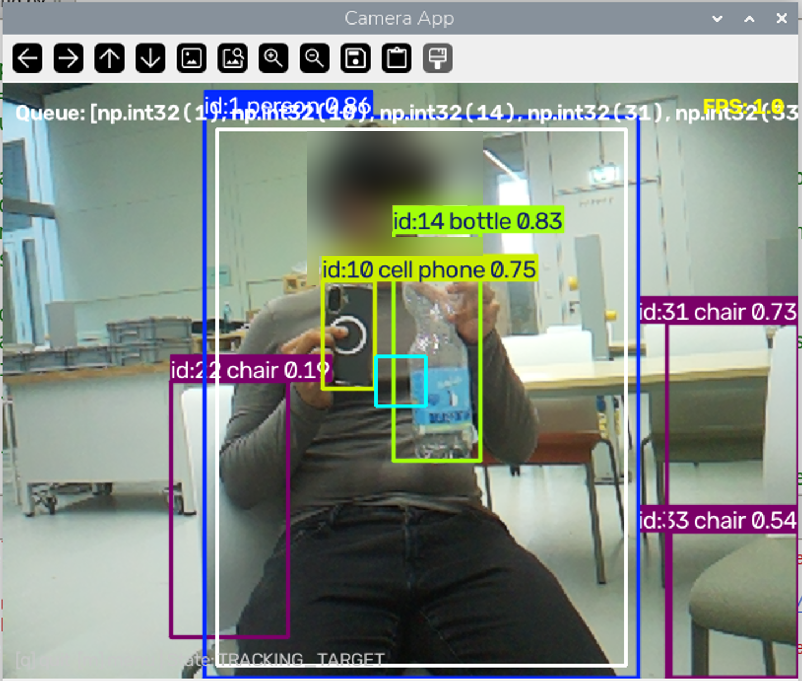
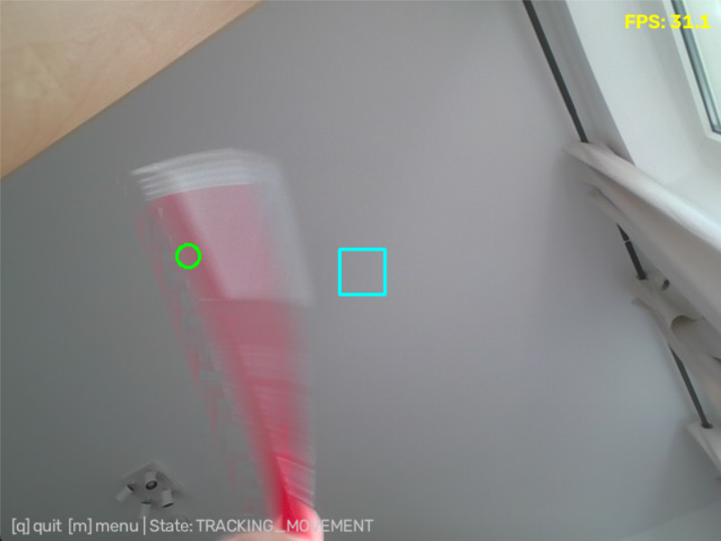
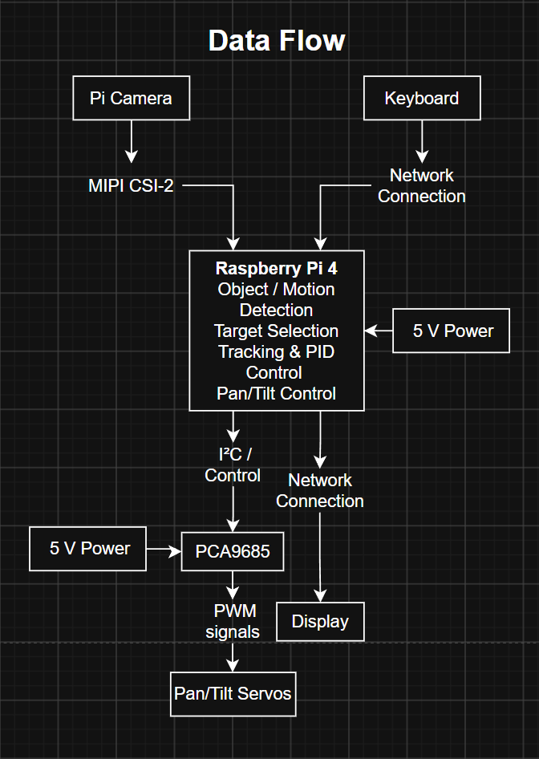
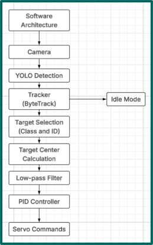
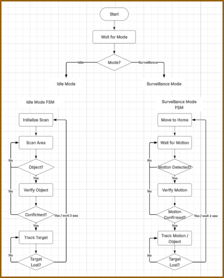
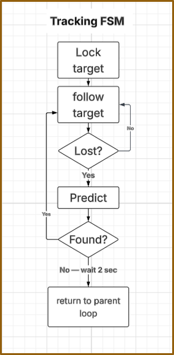
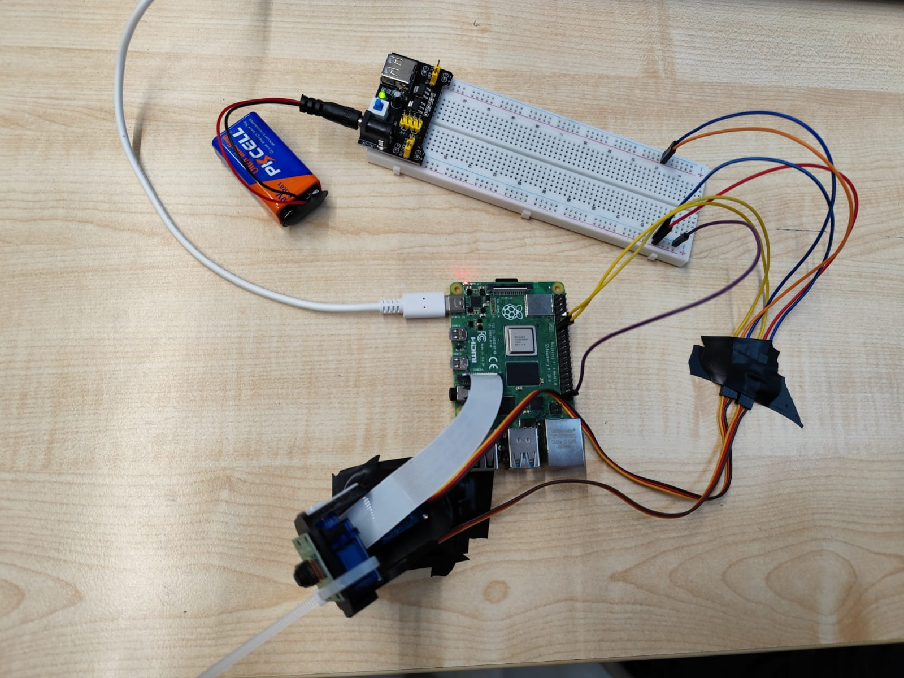
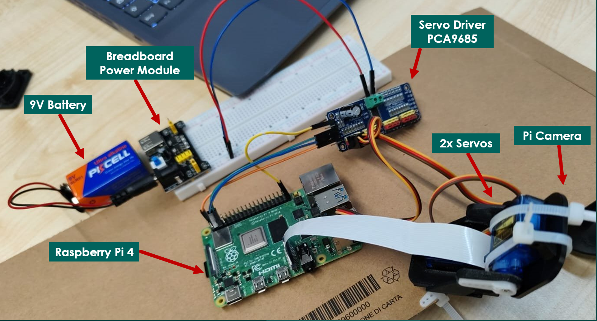
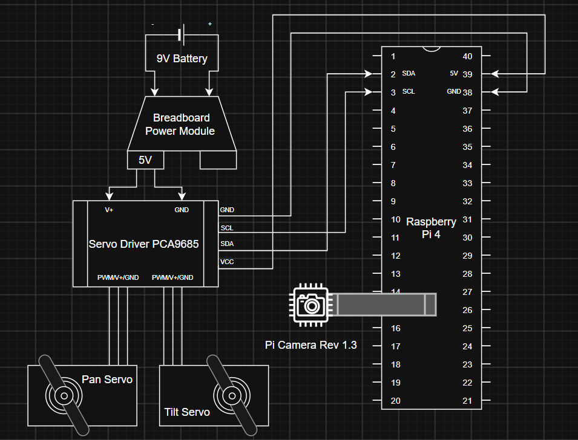
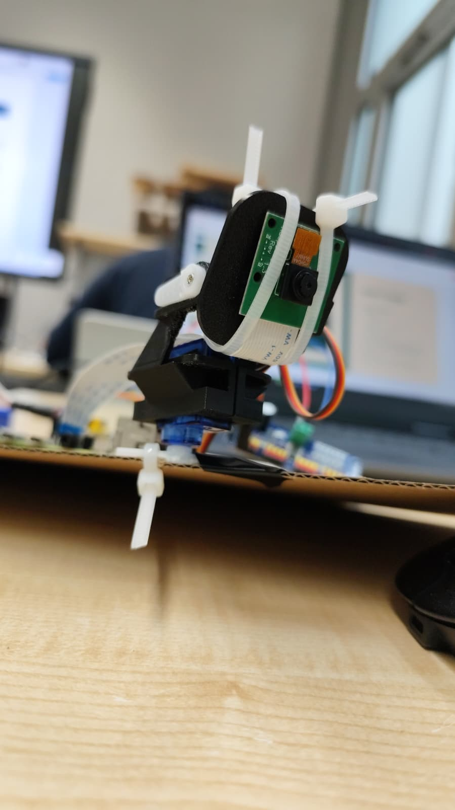

# Autonomous Pan-Tilt Camera: Computer Vision & Object Tracking


A Raspberry Pi 4 camera on a 3D-printed pan-tilt gimbal that **finds, locks onto and follows a subject on its own**, with no operator steering it. It has two operating modes:

| Mode | What it does |
|------|--------------|
| **Surveillance Mode** | Waits at a home position. When **motion** is detected (frame differencing) it tracks it with a low-pass-filtered PID loop, then returns home after 2 s without motion. |
| **Idle Mode** | Continuously **scans** a set of waypoints. Runs **YOLOv8 + ByteTrack** to detect people and cell phones, locks onto one target and PID-tracks it. Resumes scanning after 2 s without a target. |

> Final project for the *Embedded Systems Lab* (Engineering Teamwork IV). The full write-up is in [`docs/Final_Project_Report.pdf`](docs/Final_Project_Report.pdf).

## Demo

<p align="center">
  
  
</p>
<p align="center"><em>Left: Idle Mode on the Pi (detections with track IDs/confidence, target queue, locked target, FPS). Right: Surveillance Mode marking a moving object (green circle). This capture is from the dead-zone test build, so the cyan square is its dead zone.</em></p>

- ▶ [Tracking demo video](docs/media/tracking-demo.mp4) (the full system running)
- ▶ [YOLO camera test video](docs/media/yolo-camera-test.mp4) (vision-only test, no servos)

## Skills demonstrated

Computer vision (OpenCV, YOLOv8, ByteTrack) · closed-loop control (low-pass filter + PID, anti-windup) · finite state machines · embedded interfacing (I²C, CSI, PWM) · hardware debugging and staged testing · modular Python design · CAD/3D printing integration.

---

## Table of contents

1. [How it works](#how-it-works)
2. [Hardware](#hardware)
3. [Getting started](#getting-started)
4. [Usage](#usage)
5. [Testing and calibration tools](#testing-and-calibration-tools)
6. [Configuration](#configuration)
7. [Results and limitations](#results-and-limitations)
8. [Project structure](#project-structure)
9. [Credits](#credits)

---

## How it works

Every frame goes through the same pipeline, regardless of mode:

```
Camera → Detection (YOLOv8 / motion) → Tracking (ByteTrack / frame diff)
       → Target centre → Low-pass filter → PID (per axis) → PCA9685 → Pan/tilt servos
```

<p align="center">
  
  
</p>

### State machines

<p align="center">
  
  
</p>

- **Idle Mode:** `SCANNING → TRACKING_TARGET → (target lost for 2 s) → SCANNING`.
  A detection is only accepted once its confidence is above `CONFIDENCE_THRESHOLD` (0.40), and a locked target can go undetected for up to `MAX_MISSING_FRAMES` (10) frames before the lock is dropped.
- **Surveillance Mode:** `WAIT_FOR_MOTION → TRACKING_MOVEMENT → (no motion for 2 s) → WAIT_FOR_MOTION` (returns the mount to its home position).
- The 2 s timeouts are **wall-clock based, not frame based**, so they behave the same even when the frame rate changes.

### Control

1. The pixel error between the target centre and the frame centre is smoothed with a **low-pass filter** (`LPF_ALPHA = 0.35`) to suppress single-frame detection jitter.
2. An independent **PID controller per axis** turns the filtered error into a servo angle correction. The integral term is clamped to prevent windup, and the real elapsed time of each frame (`dt`) is used instead of a fixed timestep, so control degrades gracefully when the frame rate drops.
3. Angles are clamped to the calibrated mechanical limits before being written to the PCA9685.

### Why a PCA9685 over I²C?

Early on, servos driven with software PWM from the Pi **jittered visibly**, because the CPU was busy with YOLOv8 inference and OS scheduling delayed the PWM pulses. Moving PWM generation to a PCA9685 driver (over I²C) means the Pi only sends a target angle when it changes, and the driver's own oscillator produces a stable waveform regardless of CPU load.

<p align="center">
  
</p>
<p align="center"><em>Early prototype, before the PCA9685 was added.</em></p>

---

## Hardware

| Component | Role |
|-----------|------|
| Raspberry Pi 4 Model B | Runs all vision and control software |
| Raspberry Pi Camera Module Rev 1.3 (OV5647) | Video input over CSI |
| PCA9685 16-channel PWM/servo driver | Generates pan/tilt PWM over I²C |
| 2 × SG90 micro servos | Pan (channel 0) and tilt (channel 1) |
| Breadboard power module + 9 V battery | Separate servo supply, common ground with the Pi |
| 3D-printed gimbal | See [`hardware/`](hardware/) |

<p align="center">
  
</p>

**Wiring**

<p align="center">
  
</p>

- PCA9685 → Pi over I²C: **SDA = GPIO 2 (physical pin 3)**, **SCL = GPIO 3 (physical pin 5)**, plus logic power and GND. Check your Pi's pinout when wiring.
- Pan servo on PCA9685 channel **0**, tilt servo on channel **1** (configurable in `src/config.py`).
- Servo power comes from the **separate** breadboard power module into the PCA9685 `V+` terminal. **Share a common ground with the Pi.** Without it the PWM signal has no valid reference and the servos misbehave.
- Camera ribbon goes to the Pi's CSI port (separate from the I²C bus).

> **Camera note:** I used the **Camera Module Rev 1.3** because it was the camera available to me (limited resources), and all results here were recorded with it. The software also supports **Camera Module 2**: camera access lives in its own module (`camera_source.py`), so upgrading needs no changes elsewhere.

**3D-printed parts:** the gimbal is the *SG90 Servo 2-axis Gimbal* by **aanarcissus** ([Thingiverse thing:2892903](https://www.thingiverse.com/thing:2892903), CC BY-SA). See [`hardware/README.md`](hardware/README.md) for attribution and the bill of materials.

<p align="center">
  
</p>

---

## Getting started

### Raspberry Pi setup

1. **Enable I²C** (for the PCA9685): `sudo raspi-config` → Interface Options → I2C → Enable → reboot.
2. **Install Picamera2 and OpenCV via apt** (this gets the correct libcamera bindings; plain `cv2.VideoCapture(0)` usually can't see the CSI camera on modern Raspberry Pi OS):

   ```bash
   sudo apt update
   sudo apt install -y python3-picamera2 python3-opencv
   ```

3. **Clone the repo and create a virtual environment** that can see the apt packages:

   ```bash
   git clone https://github.com/JoaSebMS/autonomous-pan-tilt-camera.git
   cd autonomous-pan-tilt-camera
   python3 -m venv --system-site-packages .venv
   source .venv/bin/activate
   pip install -r requirements.txt
   ```

   `ultralytics` downloads the `yolov8n.pt` weights automatically on first run (this can take a minute on a Pi).

### Trying it without the hardware

Everything degrades gracefully, so you can develop on a laptop:

- No PCA9685 / `adafruit_servokit`? `ServoController` logs a warning and servo writes become no-ops.
- No Picamera2? `CameraSource` falls back to `cv2.VideoCapture` (any USB webcam).

---

## Usage

Run from the repository root:

```bash
# Interactive menu (needs a display, e.g. the Pi desktop or VNC)
python src/main.py

# Skip the menu
python src/main.py --mode surveillance
python src/main.py --mode idle

# Headless over SSH (no display window)
python src/main.py --mode idle --headless

# Different USB camera index (OpenCV backend only) / verbose logging
python src/main.py --camera 1
python src/main.py --debug
```

**Hotkeys** (when a window is shown): `q` quits (servos return home first), `m` goes back to the mode menu. Both can be changed in `config.py`.

---

## Testing and calibration tools

The system was validated in stages, so each possible source of error was isolated before the next was introduced:

| Stage | Tool | Purpose |
|-------|------|---------|
| 1. Vision only | [`tools/camera_test.py`](tools/camera_test.py) | Check the camera feed, motion detection and YOLO/ByteTrack in isolation, **no servos attached**. |
| 2. Servo direction | [`tools/main_no_pid.py`](tools/main_no_pid.py) | Same app but with a simple **dead-zone step controller** instead of PID: confirms wiring polarity and pan/tilt direction, and lets you check the servos for jitter. |
| 3. Full system | [`src/main.py`](src/main.py) | Full low-pass-filter + PID tracking with the PCA9685. |
| Calibration | [`tools/servo_calibration.py`](tools/servo_calibration.py) | Jog each servo with the keyboard (`w/a/s/d`) to find the safe min/max angles that **don't over-bend wires or bind the printed gimbal**. Put the results in `config.py`. |

```bash
python tools/camera_test.py --mode idle
python tools/main_no_pid.py --mode surveillance
python tools/servo_calibration.py        # run on the Pi; hold w/a/s/d to move, release to stop
```

> ⚠️ Run the calibration tool **before** the first autonomous run, and keep a hand near the power switch. The servos jump to 90° when it starts.

---

## Configuration

Everything tunable lives in [`src/config.py`](src/config.py), so you shouldn't need to edit the other modules for normal tuning.

| Setting | Value | Meaning |
|---------|-------|---------|
| `FRAME_WIDTH` × `FRAME_HEIGHT` | 640 × 480 | Capture resolution |
| `HOME_ANGLES` | (90°, 25°) | Pan/tilt home position |
| `PAN_ANGLE_LIMITS` / `TILT_ANGLE_LIMITS` | (0, 110) / (0, 170) | Safe travel limits (**re-calibrate for your mount**) |
| `PAN_PID_GAINS` / `TILT_PID_GAINS` | (0.04, 0.00005, 0) / (0.04, 0.000055, 0.0000009) | Per-axis (kp, ki, kd) |
| `PID_INTEGRAL_CLAMP` | 50 | Anti-windup limit |
| `LPF_ALPHA` | 0.35 | Low-pass filter strength (lower = smoother, laggier) |
| `TARGET_OBJECTS` | person, cell phone | YOLO classes to track (any COCO class) |
| `CONFIDENCE_THRESHOLD` | 0.40 | Minimum confidence to queue a target |
| `MAX_MISSING_FRAMES` | 10 | Frames a locked target may vanish before the lock is dropped |
| `IDLE_RESUME_SCAN_TIMEOUT` / `SURVEILLANCE_RETURN_HOME_TIMEOUT` | 2.0 s | Time without target/motion before scanning / going home |
| `SCAN_WAYPOINTS`, `SCAN_SPEED` | 6 waypoints, 9°/frame | Idle Mode scan pattern |
| `MIN_AREA`, `BLUR_SIZE`, `THRESHOLD_SENSITIVITY` | 500, 10, 25 | Motion detector sensitivity |

---

## Results and limitations

- **Surveillance Mode** is cheap to run: the captured test above shows ~30 FPS (frame differencing needs no neural network).
- **Idle Mode** reached about **1 FPS** on the Raspberry Pi 4 (CPU-only YOLOv8n with no accelerator). This is a hardware limit, not a logic bug. The system is *soft real-time*: a slow frame makes motion less smooth but never makes it unsafe, because the controller uses the measured `dt`.
- The dead-zone test confirmed correct motion direction but visible jitter; the full PID + PCA9685 build gave smooth, stable tracking in both modes.

**Limitations**

- Idle Mode locks onto one target at a time and only detects the pretrained COCO classes.
- Tested indoors in one room with stable lighting; no quantitative accuracy metrics were logged.
- Servo power is a 9 V battery through a breadboard module, which limits available current.
- Camera Module Rev 1.3 (used because of limited resources) has lower resolution and low-light performance than Camera Module 2.

**Possible improvements**

- Add an AI accelerator (e.g. Hailo AI HAT+) to bring Idle Mode closer to real time.
- Prompted detection (YOLOE-style) to track custom, non-COCO objects without training.
- Tune PID gains with a formal procedure (e.g. Ziegler–Nichols) instead of manual iteration.
- Log tracking-accuracy metrics over repeated trials.

---

## Project structure

```
.
├── README.md
├── LICENSE
├── requirements.txt
├── src/
│   ├── main.py               # Entry point: menu + both modes + shared helpers
│   ├── config.py             # Every tunable value
│   ├── servo_controller.py   # PCA9685 driver: low-pass filter + PID + area scan
│   └── camera_source.py      # Picamera2 (CSI) or OpenCV (USB) behind one interface
├── tools/
│   ├── camera_test.py        # Vision-only test, no servos
│   ├── main_no_pid.py        # Dead-zone controller for wiring/direction checks
│   └── servo_calibration.py  # Keyboard jog tool to find safe angle limits
├── hardware/
│   ├── README.md             # Bill of materials + gimbal attribution
│   └── stl/                  # base.stl, HolderL.stl, HolderR.stl
└── docs/
    ├── Final_Project_Report.pdf
    ├── images/               # diagrams/, hardware/, results/
    └── media/                # demo videos
```

---

## Credits

- Pan-tilt gimbal design: [*SG90 Servo 2-axis Gimbal*](https://www.thingiverse.com/thing:2892903) by **aanarcissus**, licensed [CC BY-SA](hardware/stl/LICENSE-gimbal.txt) (see [`hardware/README.md`](hardware/README.md)).
- [Ultralytics YOLOv8](https://github.com/ultralytics/ultralytics) and [ByteTrack](https://github.com/ifzhang/ByteTrack) for detection and tracking.
- [Adafruit ServoKit](https://github.com/adafruit/Adafruit_CircuitPython_ServoKit) for the PCA9685, [Picamera2](https://github.com/raspberrypi/picamera2) for the CSI camera, and [OpenCV](https://opencv.org/).
- Inspiration from pan-tilt tracking tutorials by Core Electronics and others (full list in the [report](docs/Final_Project_Report.pdf)).

## Author

**Joaquín Sebastian Morillo Soto**: [GitHub](https://github.com/JoaSebMS) · [LinkedIn](https://www.linkedin.com/in/joaqu%C3%ADn-sebastian-morillo-soto/)

## License

Code and documentation: [MIT](LICENSE). The 3D-printed parts in `hardware/stl/` are by aanarcissus and keep their original [CC BY-SA license](hardware/stl/LICENSE-gimbal.txt) (see [`hardware/README.md`](hardware/README.md)).
